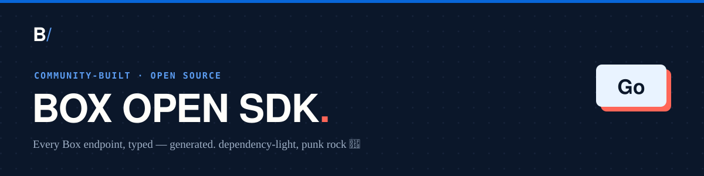

<!-- Generated by box-gantry. DO NOT EDIT — regenerate from the specs instead. -->


# box-open-sdk (Go)

[](https://github.com/unofficialbox/box-open-go-sdk/releases/latest)
[](https://pkg.go.dev/github.com/unofficialbox/box-open-go-sdk)
[](LICENSE)

An **open source, community-built** Box API client for Go — typed models for the whole
Box surface, one manager per API area behind a single `Client`, and a
`net/http` runtime with retry, exponential backoff, `Retry-After` handling, and
automatic token refresh. Standard library only; no third-party dependencies.

> **Not affiliated with, authorized, or endorsed by Box, Inc.** "Box" is a
> trademark of Box, Inc. This is an independent, generated client.

## Install

```sh
go get github.com/unofficialbox/box-open-go-sdk@latest
```

## Quickstart

Authenticate, look up the current user, create a folder, upload a file, extract
its fields with Box AI, tag it with metadata, and query for it — end to end:

```go
package main

import (
	"context"
	"fmt"
	"log"
	"strings"

	"github.com/unofficialbox/box-open-go-sdk/auth"
	"github.com/unofficialbox/box-open-go-sdk/client"
	"github.com/unofficialbox/box-open-go-sdk/schemas"
)

func main() {
	ctx := context.Background()

	// Client Credentials Grant (server-to-server); developer token, OAuth, and
	// JWT are also supported — see docs/auth.md.
	c := client.NewClient(auth.ClientCredentials(auth.CCGConfig{
		ClientID:     "CLIENT_ID",
		ClientSecret: "CLIENT_SECRET",
		EnterpriseID: "ENTERPRISE_ID",
	}))

	// The current user.
	me, err := c.Users.GetMe(ctx, nil)
	if err != nil {
		log.Fatal(err)
	}
	fmt.Println("authenticated as", me.Id)

	// Create a folder at the account root ("0").
	folder, err := c.Folders.Create(ctx, &schemas.CreateFolderRequest{
		Name:   "Invoices",
		Parent: schemas.AttributesParent{Id: "0"},
	}, nil)
	if err != nil {
		log.Fatal(err)
	}

	// Upload a file into it.
	uploaded, err := c.Uploads.UploadFile(ctx, &schemas.CreateFileContentRequest{
		Attributes: schemas.PostFileContentAttributes{
			Name:   "invoice.pdf",
			Parent: schemas.AttributesParent{Id: folder.Id},
		},
		File: strings.NewReader("<file bytes>"),
	}, nil)
	if err != nil {
		log.Fatal(err)
	}
	fileID := uploaded.Entries[0].Id

	// Extract fields from the file with Box AI.
	answer, err := c.Ai.Extract(ctx, &schemas.AiExtract{
		Prompt: "Extract the invoice number and total amount.",
		Items:  []schemas.AiItemBase{{Id: fileID, Type: schemas.AiCitationTypeFile}},
	})
	if err != nil {
		log.Fatal(err)
	}
	fmt.Println(answer)

	// Attach that metadata to the file (an enterprise template).
	if _, err := c.FileMetadata.CreateFileMetadata(ctx, fileID,
		schemas.GetFileIdMetadataIdScopeEnterprise, "invoiceData",
		map[string]any{"invoiceNumber": "INV-0042", "total": 1250}); err != nil {
		log.Fatal(err)
	}

	// Query for files carrying that metadata.
	results, err := c.Search.QueryByMetadata(ctx, &schemas.MetadataQuery{
		From:             "enterprise_0.invoiceData",
		AncestorFolderId: folder.Id,
	})
	if err != nil {
		log.Fatal(err)
	}
	fmt.Println(results)
}
```

## Authentication

Box's four auth flows all live in the `auth` package — **developer token**,
**client credentials (CCG)**, **OAuth 2.0** (with a pluggable refresh-token
store), and **JWT** (server auth). See [`docs/auth.md`](./docs/auth.md).

## HTTP versions

API requests negotiate HTTP/2 over TLS and fall back to HTTP/1.1. Pin HTTP/1.1
with `WithHTTPVersion`, or pass your own `*http.Client` with `WithHTTPClient` —
e.g. one with an HTTP/3 transport; the standard library has none built in:

```go
c := client.NewClient(tokenSource, gantryruntime.WithHTTPVersion(gantryruntime.HTTP1))
```

`gantryruntime` is `github.com/unofficialbox/box-open-go-sdk/gantryruntime`. Token requests keep their own client.

## Documentation

API reference on [pkg.go.dev](https://pkg.go.dev/github.com/unofficialbox/box-open-go-sdk); the [`docs/`](./docs)
tree carries the per-manager reference — a call snippet for every method — and
the authentication, pagination, and errors guides.

## License

MIT. Generated by [box-gantry](https://github.com/unofficialbox/box-gantry).
